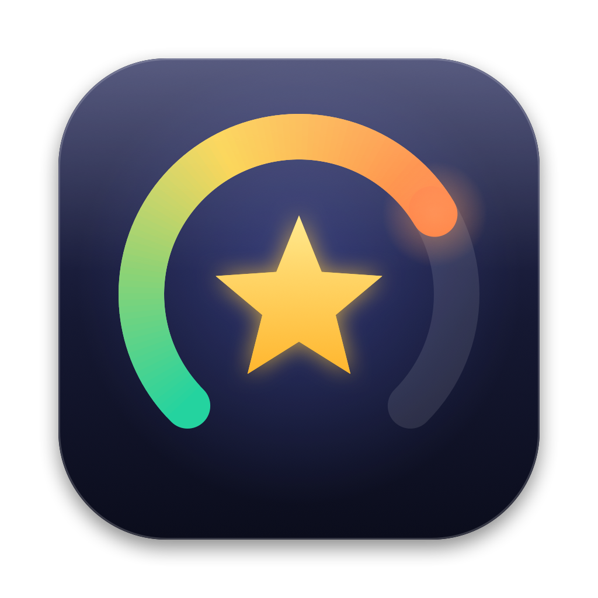
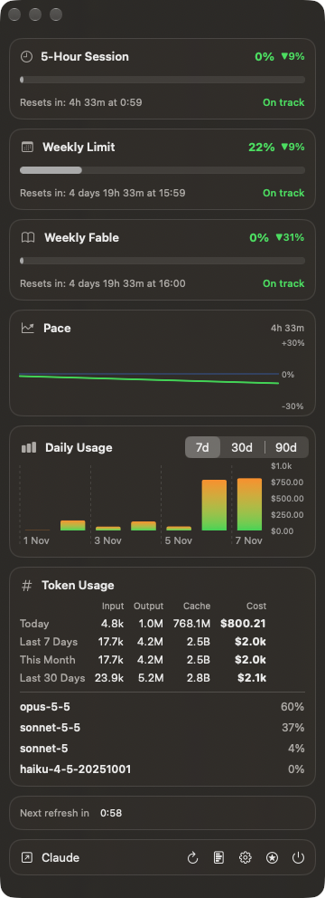
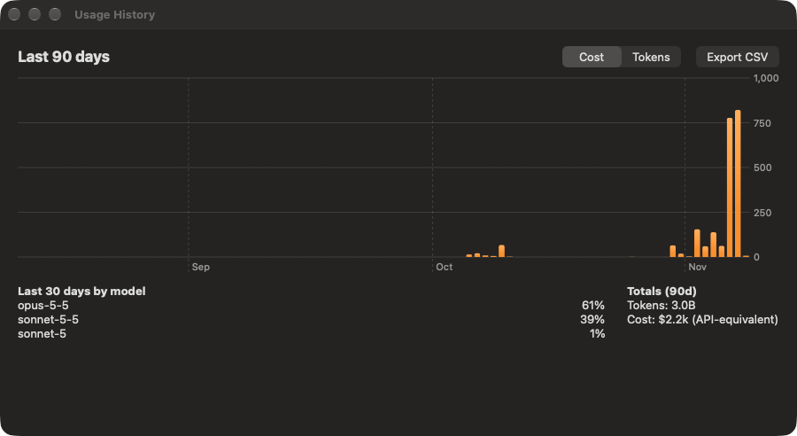
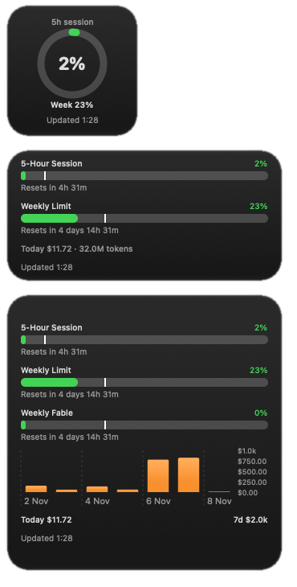
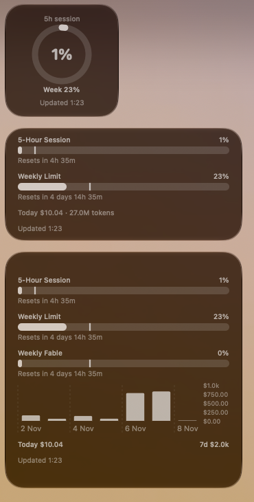

<p align="center"></p>

# Claude Usage Widget

A native macOS menu bar app (plus desktop widgets) that shows your **Claude Code usage** at a glance: 5-hour session, weekly limit, pace, 90-day token and cost history, and smart notifications.

**[⬇️ Download the latest release](https://github.com/israelio/claude-usage-widget/releases/latest)** · [All releases](https://github.com/israelio/claude-usage-widget/releases)

> ⭐ **Staraware.** Instead of paying, pay with a star. If you like it, [star the repo](https://github.com/israelio/claude-usage-widget). Made by Ohad Israeli.

## Screenshots

<table>
  <tr>
    <td valign="top" align="center">
      <br>
      <sub>The panel: limits, pace, daily usage, tokens and plan</sub>
    </td>
    <td valign="top" align="center">
      <br>
      <sub>90-day usage history: cost or tokens, model breakdown, CSV export</sub>
    </td>
  </tr>
</table>

### Desktop widgets

<table>
  <tr>
    <td align="center" valign="top">
      <br>
      <sub><b>Full-color style</b></sub>
    </td>
    <td align="center" valign="top">
      <br>
      <sub><b>Monochrome style</b> (macOS default "Automatic")</sub>
    </td>
  </tr>
</table>

Small, medium and large widgets. Add them from **Edit Widgets** on the desktop and click a widget to open the panel. macOS shows desktop widgets in the monochrome style unless you pick **System Settings → Desktop & Dock → Widgets → Widget style → Full-color**; the widgets are readable in both.

## Features

Top to bottom, the panel shows its title and version, then:

- **5-Hour Session / Weekly Limit / Weekly Fable** — percent used, a progress bar, and when the window resets (countdown plus clock time). The green/red `▼9%` / `▲9%` next to the percent is how far you are below/above a perfectly even burn rate for that window. The label on the right says **On track**, **Ahead of pace** or **Will exceed**, based on where your current rate would land at reset. The third card is the per-model weekly window (Fable, when your plan has one).
- **Pace** — a chart of your pace over the current 5-hour window. Above the 0% line means you are using it faster than evenly; below means slower. It fills in as the app collects samples.
- **Daily Usage** — cost per day with a **7d / 30d / 90d** switch.
- **Token Usage** — input, output and cache tokens plus cost for Today, Last 7 Days, This Month and Last 30 Days, then each model's share of your last 30 days of spend. Costs are API-equivalent estimates from an editable price table, not your subscription bill.
- **Plan** — your plan (for example Max 5x) and subscription status, the estimated renewal date, and extra-usage spend if you have it enabled. Anthropic doesn't expose the renewal date, so it is estimated as the next monthly anniversary of your subscription start; annual plans renew on a different schedule.
- **Next refresh** — countdown to the next poll. If the live endpoint is unreachable it shows "updated Xm ago" or an "estimated" badge instead.
- **Footer** — open Claude's usage page, refresh now, open the 90-day History window, Settings, About, and Quit.

More:

- **Menu bar** — a compact label such as `🟢 42% ▼7% · 71%` (colour shows how close you are to the limit). Choose session %, session + weekly, or icon only in Settings.
- **Floating panel** — turn on *Floating always-on-top panel* in Settings to pin the same view on your desktop. It remembers its position.
- **90-day history** — a daily chart you can switch between cost and tokens, last-30-day model breakdown, totals, and **Export CSV**.
- **Smart notifications**
  - *Thresholds*: one alert per window at the highest level crossed (default 50/75/90%, editable).
  - *Burn-rate warning*: you are on course to hit the limit before it resets.
  - *Reset notice*: your window reset and usage is available again.
  - *Digests*: a daily summary and a Monday weekly summary of tokens and cost, at an hour you choose.
  - *Quiet hours*: suppress alerts overnight.
- **Desktop widgets** — small (session ring), medium (session + weekly + today's cost) and large (adds weekly Fable and a 7-day chart). They need a build signed with your Apple Team ID (see below).
- **Settings** — refresh interval, menu bar mode, notification options, fallback token budgets, and the per-model price table.
- **Offline fallback** — if the usage endpoint or Keychain is unavailable, usage is estimated from your local logs and marked as estimated. The last real values are kept and shown as stale rather than replaced.
- **Light and dark** — follows your system appearance with a glass material.

## Requirements

- macOS 14 or later
- Claude Code installed and signed in (the app reads its login from the Keychain and its logs from `~/.claude/projects`)
- To build: Xcode 16+ and [XcodeGen](https://github.com/yonaskolb/XcodeGen) (`brew install xcodegen`)

## Install

1. Go to the **[latest release](https://github.com/israelio/claude-usage-widget/releases/latest)** and download `ClaudeUsage-<version>.dmg` (a `.sha256` checksum is next to it).
2. Open the DMG and drag **Claude Usage** onto **Applications**.
3. Launch it. Releases from 0.1.1 on are signed with a Developer ID and notarized by Apple, so it opens normally. (The older 0.1.0 was unsigned: right-click → **Open**.)
4. The app reads your Claude Code login from the Keychain through Apple's `security` tool, normally without a prompt. If macOS does ask, choose **Always Allow** ([details](#keychain-access)).
5. Look for the usage label in your menu bar. Click it to open the panel.
6. For the desktop widgets: right-click the desktop → **Edit Widgets** → search "Claude Usage".

## Updates

The app checks GitHub Releases every 6 hours. When a newer version exists it downloads the DMG, verifies the SHA-256 checksum and that the new app is notarized and signed by the same Developer ID team, then replaces itself and restarts. Turn this off under Settings > Updates ("Install updates automatically"); you will then get a notification instead. You can also use "Check for updates" in the About popover. Builds without a team ID (unsigned or development builds) only notify and link to the release page.

## Keychain access

Claude Code keeps your login (an OAuth token) in your macOS Keychain under the name "Claude Code-credentials". Your 5-hour and weekly limit percentages are only available from Anthropic's servers, and the app needs that same token to ask for them.

- **No password prompt in normal use.** The app reads the token through Apple's built-in `security` command-line tool, which that Keychain item already trusts (Claude Code writes the item with the same tool). It reads the token once per launch, keeps it in memory only, and re-reads only when the token is close to expiring or was rejected.
- **If macOS still asks** (for example on a Mac where the tool isn't trusted by the item), the dialog reads *"Claude Usage wants to access key 'Claude Code-credentials'"*. Enter your login password and choose **Always Allow**. Plain "Allow" is valid for one read only. Claude Code resets the item's trusted list whenever it refreshes its login, so that prompt can come back after a refresh.
- **What the app does with the token:** it uses it for calls to Anthropic's usage and account endpoints (`api.anthropic.com`) and nothing else. It never writes the token to disk, logs it, or changes anything in your Keychain.
- **If access is denied:** the app still works with token counts and cost from your local logs and an *estimated* usage percentage, but not the real limits.

## Build from source

```sh
git clone https://github.com/israelio/claude-usage-widget.git
cd claude-usage-widget
cp Local.xcconfig.example Local.xcconfig   # then edit it (see below)
xcodegen generate
open ClaudeUsageWidget.xcodeproj           # run the ClaudeUsageWidget scheme
```

`Local.xcconfig` holds your signing settings and is **gitignored** (never commit it):

```
DEVELOPMENT_TEAM = ABCDE12345
APP_GROUP_ID = ABCDE12345.com.ohad.claudeusagewidget
```

- Find your Team ID at developer.apple.com/account → Membership details.
- The App Group is how the app shares data with the widgets. On macOS 15+ it should be prefixed with your Team ID.

Unsigned build (menu bar app only, no widgets):

```sh
xcodebuild -project ClaudeUsageWidget.xcodeproj -scheme ClaudeUsageWidget \
  -configuration Debug -destination 'platform=macOS' \
  CODE_SIGNING_ALLOWED=NO CODE_SIGN_IDENTITY="" build
```

## How it works

| Piece | Source |
|---|---|
| 5h / weekly limits and resets | Claude's usage endpoint, authenticated with the Claude Code OAuth token from the Keychain |
| Tokens and history | Incremental parse of `~/.claude/projects/**/*.jsonl`, deduplicated by message id |
| Cost | Editable per-model price table (Settings) |
| Fallback | Local token estimate vs. budgets you configure in Settings |

Code layout:

- `Packages/UsageCore` — parsing, pricing, history, pace, alerts, limits client (unit tested)
- `App/` — SwiftUI menu bar app, popover, floating panel, settings, history
- `Widget/` — WidgetKit extension
- `project.yml` — XcodeGen project definition
- `scripts/make-dmg.sh` — builds a DMG

Run the tests:

```sh
swift test --package-path Packages/UsageCore
```

## Notes and limitations

- **Costs are API-equivalent estimates**, not what a subscription plan bills. Check the default prices in Settings; they may lag current Anthropic pricing.
- The usage endpoint is **undocumented** and may change. That is why the local fallback exists.
- The login token is only read from the Keychain, kept in memory and sent to Anthropic's API; it is never logged or written to disk. See [Keychain access](#keychain-access).

## License

[MIT](LICENSE) © 2026 Ohad Israeli
